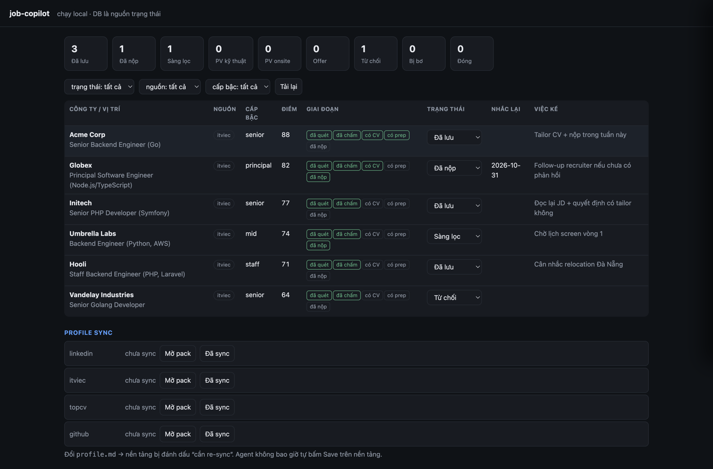
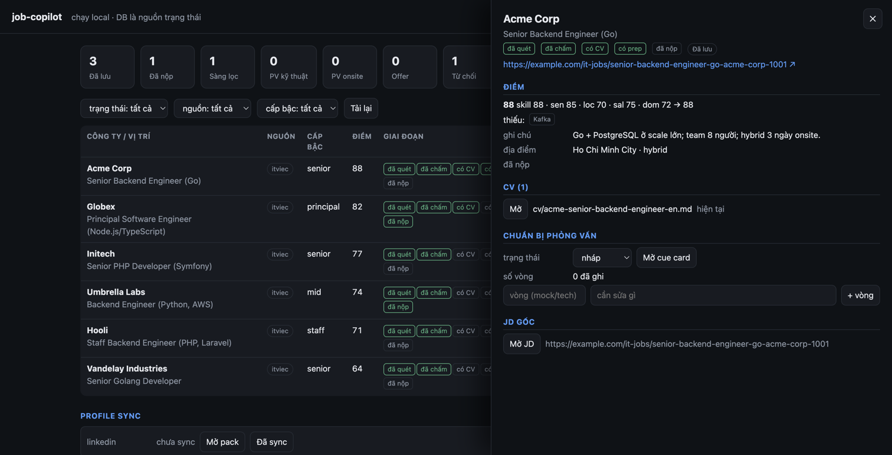

# job-copilot

A repeatable, **honest** job-hunt pipeline that runs inside [opencode](https://opencode.ai): scan job boards → triage → score against your profile → tailor a truthful CV per JD → track applications → compare offers → onboard.

It is **not** an auto-apply bot. A human reviews and submits every application. The value is a controlled pipeline and a CV that never lies.

## The idea in one line

`Setup → Scope → Scan → Extract & Score → Tailor CV → Apply → Interview Prep → Track → Offers → Onboard → Loop`

Full detail: **[WORKFLOW.md](WORKFLOW.md)**.

## Screenshots

The local UI (`http://127.0.0.1:8765`) on throwaway demo data — placeholder companies, no personal data:





## What's in the repo

| Path | What it is | Shared? |
|---|---|---|
| `.opencode/skills/job-hunt/` | Orchestration skill (the pipeline) + per-source references | ✅ |
| `.opencode/skills/vn-it-cv/` | CV generate/review/score skill + templates + scripts | ✅ |
| `.opencode/skills/profile-sync/` | `profile.md` → LinkedIn / ITviec / TopCV / GitHub packs (+ prefill guardrails) | ✅ |
| `tools/jobcopilot/` | State store (SQLite) + `jc` CLI + local UI (`docs/spec-db-ui.md`) | ✅ |
| `profile.example.md` | Template for your source-of-truth profile | ✅ |
| `jobs/_example.md` | Job-posting schema (frontmatter + raw JD) | ✅ |
| `cv/_example-en.md` | Tailored-CV shape (with `<!-- e001 -->` trace) | ✅ |
| `offers/_example.md` | Offer-comparison schema | ✅ |
| `prep/_example.md` | Interview-prep cue card (JD digest + company brief + tech/non-tech) | ✅ |
| `sync/_example.md` | Shape of a `sync/<platform>.md` profile pack (generic) | ✅ |
| `WORKFLOW.md` / `ONBOARDING.md` / `PREREQUISITES.md` | Docs | ✅ |
| `profile.md`, `jobs/*`, `cv/*`, `offers/*`, `prep/*`, `sync/*`, `jobcopilot.db*` | **Your personal data** | ❌ gitignored |

Your data stays local. Cloning the repo gives you the tool; you bring your own profile.

## Quickstart

```bash
git clone <this repo> job-copilot
cd job-copilot
git config core.hooksPath .githooks                     # enable the commit leak gate (not cloned)
cp profile.example.md profile.md                       # then fill it (see ONBOARDING.md)
python3 tools/jobcopilot/cli.py init                   # create jobcopilot.db (state store)
python3 tools/jobcopilot/server.py                     # UI at http://127.0.0.1:8765
opencode                                               # run opencode from inside the repo
```

Only Python 3 (stdlib) is needed — no deps, no Docker. State (status, dedupe,
runs) lives in `jobcopilot.db` (gitignored); content stays in `jobs/`, `cv/`,
`prep/`, `offers/`, `profile.md`. Move your state on the UI; let the agent do the
scanning/tailoring. Existing Markdown is imported once with `cli.py import`.
Before saving a job, `cli.py dedupe-check <url> --jd-file jobs/<id>.md` also flags
cross-channel reposts (an agency copy of a named employer's post) by the numbers
and terms that survive a rewrite, and names the probable employer as `[infer]`.

Then, in opencode, just talk:
- "set up my profile from this CV: /path/to/cv.pdf"
- "scan ITViec for senior backend in HCMC, 3 pages"
- "tailor a CV for that Acme job"
- "I applied to Acme — log it"
- "prep me for the Acme interview"
- "mock interview me for the Acme tech round"
- "update my LinkedIn profile" (pack + prefill; **you** press Save)

The `job-hunt` and `vn-it-cv` skills are project-local, so **you must run opencode from inside the repo**.

## Tests

```bash
./scripts/e2e.sh          # dry-run: prints the steps, changes nothing
./scripts/e2e.sh --run    # full E2E in a throwaway temp clone (DB/CLI/UI + vn-it-cv)
```

Everything runs in `$TMPDIR/jobcopilot-e2e`; your real data and DB are never touched.

## Prerequisites

See **[PREREQUISITES.md](PREREQUISITES.md)** — opencode, the `chrome-devtools` MCP, and the `jev` tool for triage.

## The honesty guarantee

- `profile.md` is the single source of truth; every experience bullet has a stable `evidence_id`.
- A tailored CV may only **select / reorder / reword** — never invent. Every bullet keeps its `<!-- e001 -->` trace.
- `scripts/selfcheck_cv.py` fails if a CV references an unknown evidence id, claims a skill not backed by an evidence bullet / `confirmed: true` skill in `profile.md`, puts an unbacked tech in a role's `**Tech:**` line, or leaks a template placeholder into the header. Summary metrics are warn-only by default.
- `scripts/ats_check.py` simulates ATS text extraction (email / phone / profile URL, section order, per-role dates) and flags a stale or rasterized PDF, a 3-page overflow, or a sparse page 2.
- No auto-apply. Ever.

## License

MIT.
